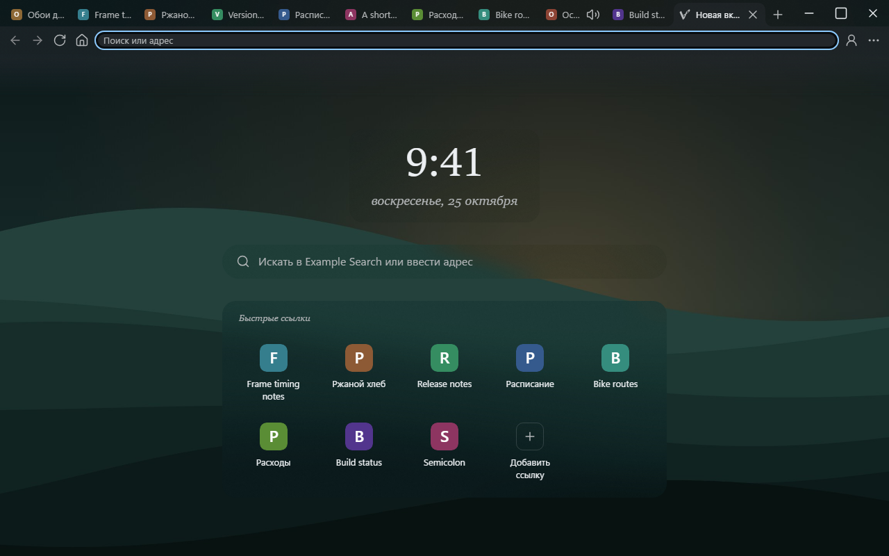
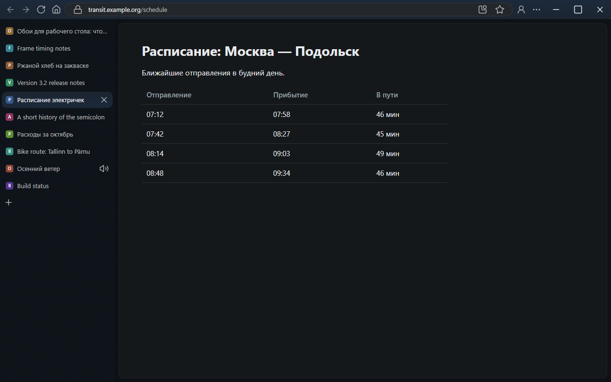
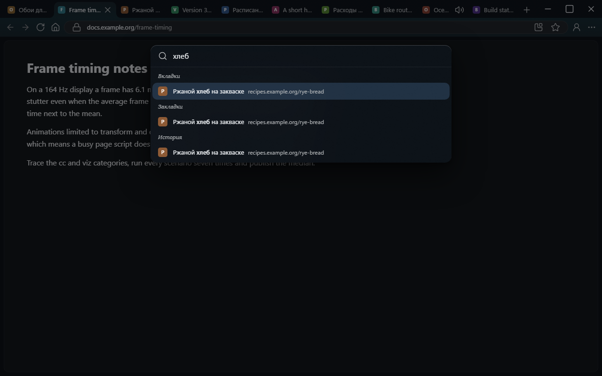
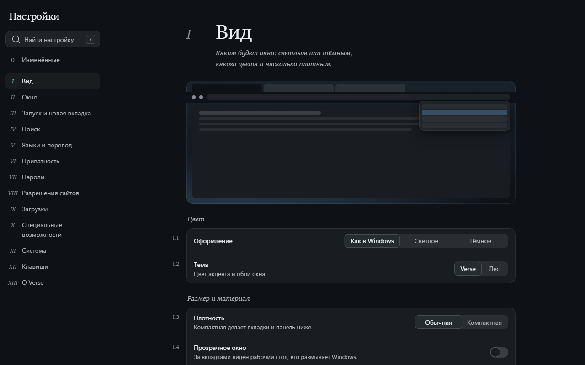

  

<h1 align="center">Verse</h1>

  A Chromium browser for Windows with its own interface and no telemetry.

  <a href="../../releases">Releases</a> (no public builds yet)
  &nbsp;·&nbsp;
  <a href="README.md">Русский</a>

  

Verse is built on Chromium 158, so sites, extensions and developer tools work as they do in Chrome. We wrote the window, tabs, menus, settings and start page ourselves.

## Features

**Glass window.** Tabs, the address bar, menus and the sidebar sit on a blurred layer that shows the wallpaper or your desktop through it. Web pages are left untouched. Settings offer eight glass presets plus your own, and the glass turns off entirely.

**Tabs on top or on the side.** The sidebar shows full tab titles. Tabs go into groups, and two tabs can open side by side in one window.

**One search for everything.** The command palette searches open tabs, bookmarks and history at once.

**Start page.** A clock, search and quick links. Turn a block off and it is gone, not hidden.

**Page translation.** Translation runs on your device: the model downloads once, and page text stays on your computer. Google, Yandex and DeepL can be added in settings; they are off by default.

**Ad and tracker blocking.** uBlock Origin is built in and works from the first launch. Other extensions install from the Chrome Web Store.

**Look and language.** Russian and English interface, two themes, light and dark modes, regular and compact density.

  
  

  

## Privacy

Verse collects no statistics and sends no reports. Google account sign-in, Google sync, Safe Browsing, field trials and Google's AI features are removed from the build.

The browser itself goes online for search suggestions while you type an address, for extensions and their updates, for uBlock Origin filters every few days, for the Widevine component that plays protected video, and for translation models after you agree. It also opens a connection to Google ahead of time when Google is your search engine, so results arrive sooner. Each of these requests can be turned off in settings.

## Install

1. Download `VerseSetup-<version>.exe` from [Releases](../../releases/latest).
2. Run it. No administrator rights needed: Verse installs to `%LOCALAPPDATA%\Verse` for the current user.

The installer is not signed yet, so Windows SmartScreen may stop it. Click "More info", then "Run anyway".

A first install puts a shortcut on the desktop; a checkbox under "Options" in the installer turns that off. An update adds no shortcut unless you tick the box under the button.

Requires 64-bit Windows 10 or 11.

## Update

Download the new installer and run it over the old version: bookmarks, history and settings stay. If Verse is open, the installer offers to close it and then updates it.

Builds do not update themselves yet. Once they do, the browser will fetch a signed list of versions and the new installer from this repository. You will be able to turn the check off.

## Bugs and requests

Open an [issue](../../issues). For a bug, include the version from `verse://settings`, section "About Verse", and the steps that lead to it.

## Authors

Verse is made by [GlouFom](https://github.com/GlouFom) and [TheNeriz](https://github.com/TheNeriz).

## Licenses

Verse uses Chromium and other open-source components. Their licenses and authors are listed at `verse://credits`.
