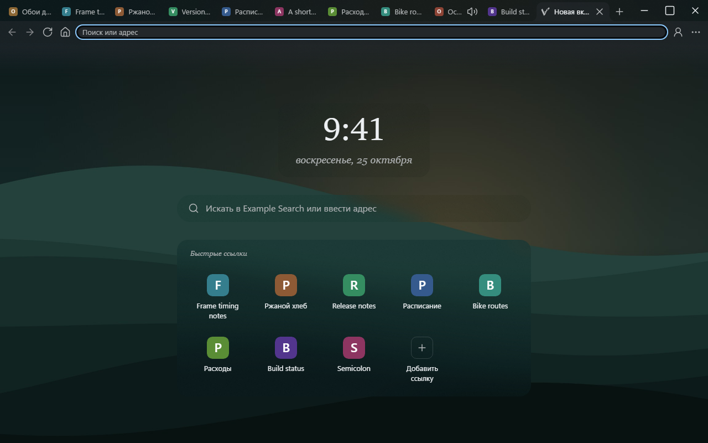
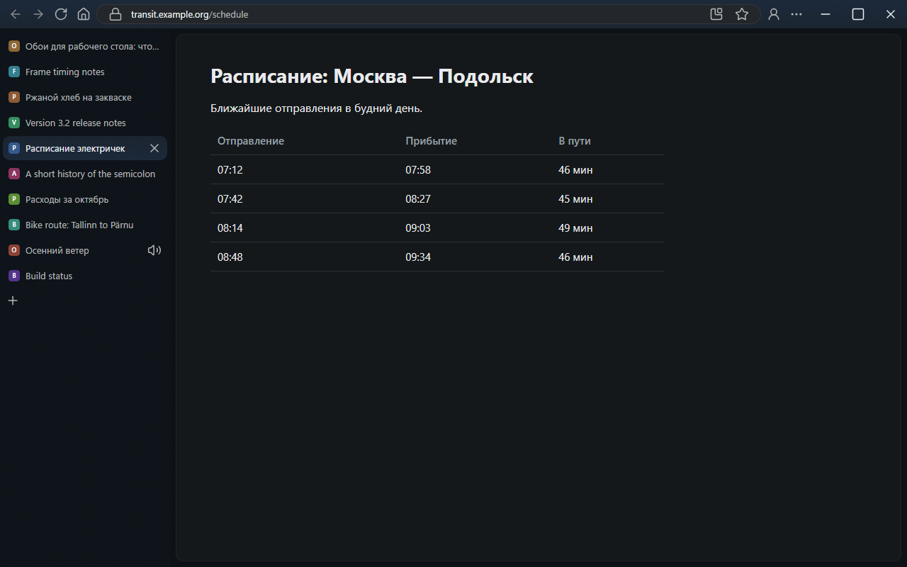
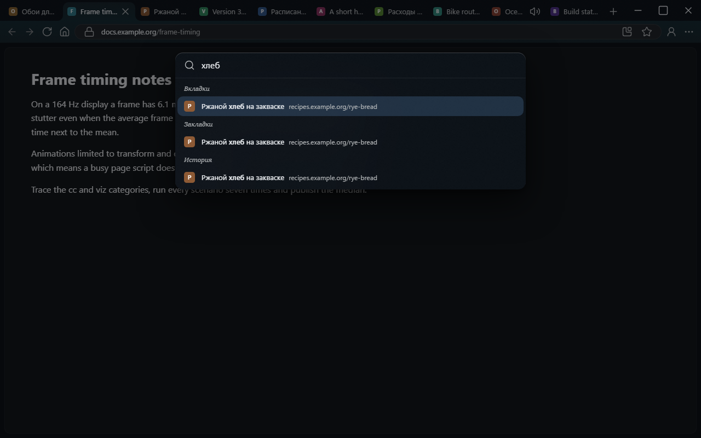
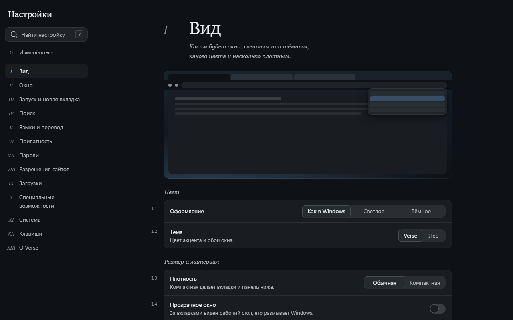

  

<h1 align="center">Verse</h1>

  Браузер на Chromium для Windows со своим интерфейсом и без телеметрии.

  <a href="../../releases/latest">Скачать для Windows</a>
  &nbsp;·&nbsp;
  <a href="README.en.md">English</a>

  

Verse построен на Chromium 158, поэтому сайты, расширения и инструменты разработчика работают как в Chrome. Окно, вкладки, меню, настройки и стартовую страницу мы написали сами.

## Что умеет

**Окно из стекла.** Вкладки, адресная строка, меню и боковая панель лежат на размытом слое, через него видны обои или рабочий стол. Страницы сайтов стекло не трогает. В настройках восемь готовых наборов стекла и свой, а ещё стекло выключается целиком.

**Вкладки сверху или сбоку.** Боковая панель показывает полные названия вкладок. Вкладки собираются в группы, две вкладки открываются рядом в одном окне.

**Один поиск по всему.** Палитра команд ищет сразу по открытым вкладкам, закладкам и истории.

**Стартовая страница.** Часы, поиск и быстрые ссылки. Любой блок выключается, и тогда его нет совсем.

**Перевод страниц.** Перевод идёт на устройстве: модель скачивается один раз, текст страницы никуда не уходит. Google, Яндекс и DeepL можно подключить в настройках, по умолчанию они выключены.

**Блокировка рекламы и трекеров.** uBlock Origin встроен и работает с первого запуска. Остальные расширения ставятся из Chrome Web Store.

**Вид и язык.** Интерфейс на русском и английском, две темы, светлое и тёмное оформление, обычная и компактная плотность.

  
  

  

## Приватность

Verse не собирает статистику и не отправляет отчёты. Вход в аккаунт Google, синхронизация через Google, Safe Browsing, полевые испытания и ИИ-функции Google вырезаны из сборки.

Сам браузер обращается в сеть за подсказками поисковика при вводе адреса, за расширениями и их обновлениями, за фильтрами uBlock Origin раз в несколько дней, за компонентом Widevine для защищённого видео и за моделями перевода после вашего согласия. Ещё он заранее открывает соединение с Google, если это ваш поисковик, чтобы результаты приходили быстрее. Каждый из этих запросов выключается в настройках.

## Установка

1. Скачайте `VerseSetup-<версия>.exe` со страницы [Releases](../../releases/latest).
2. Запустите. Права администратора не нужны: Verse ставится в `%LOCALAPPDATA%\Verse` для текущего пользователя.

Установщик пока не подписан, поэтому Windows SmartScreen может его остановить. Нажмите «Подробнее», затем «Выполнить в любом случае».

При первой установке на рабочем столе появляется ярлык, галочка в «Параметрах» установщика это отключает. При обновлении ярлык не добавляется, пока вы не поставите галочку под кнопкой.

Нужна Windows 10 или 11, 64-разрядная.

## Обновление

Скачайте новый установщик и запустите его поверх: закладки, история и настройки сохранятся. Если Verse открыт, установщик предложит закрыть его и обновит сам.

Автообновления в сборках пока нет. Когда оно появится, браузер будет брать из этого репозитория подписанный список версий и новый установщик. Проверку можно будет выключить.

## Ошибки и предложения

Пишите в [Issues](../../issues). Для ошибки укажите версию из `verse://settings`, раздел «О Verse», и шаги, после которых она появляется.

## Лицензии

Verse использует Chromium и другие открытые компоненты. Их лицензии и авторы перечислены на странице `verse://credits`.
